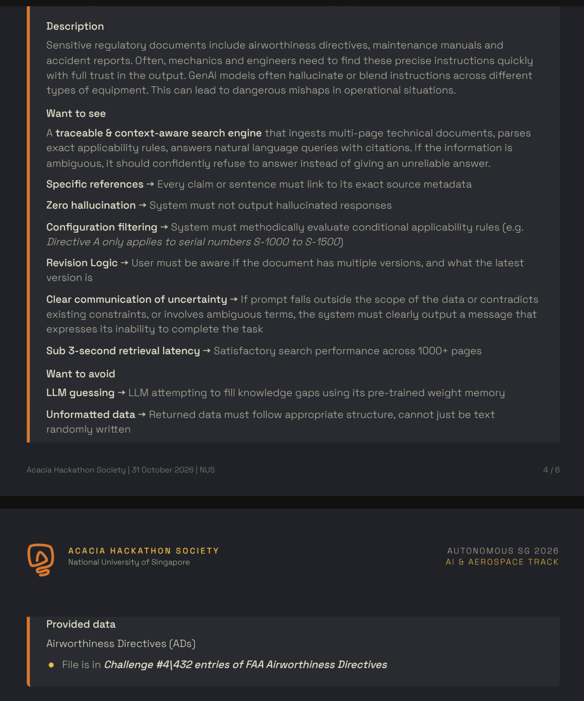
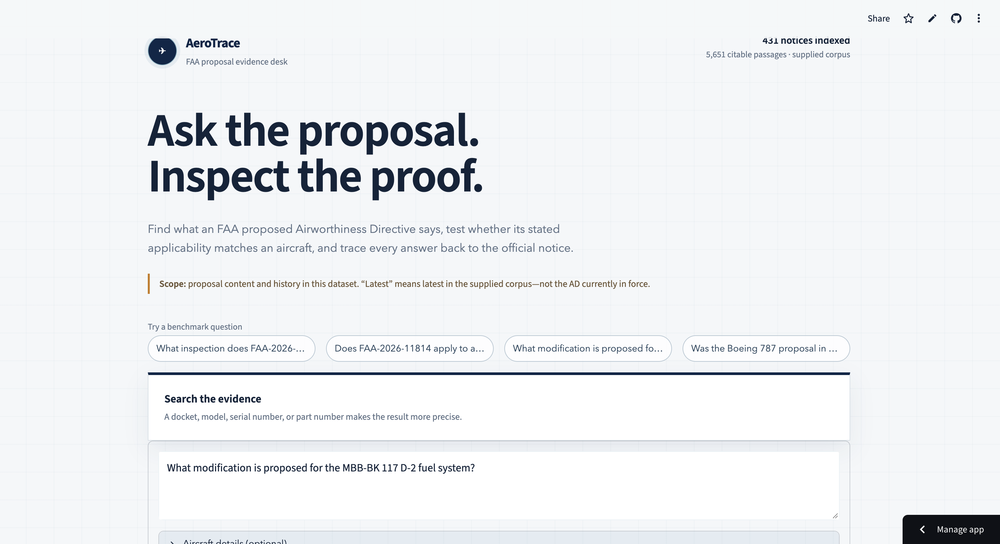
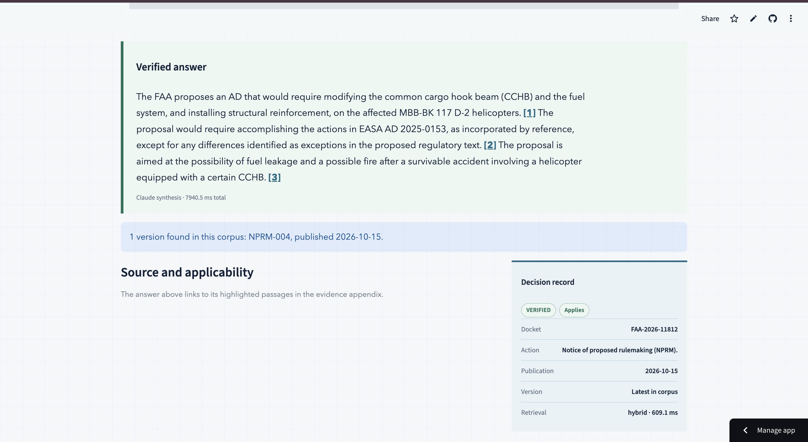
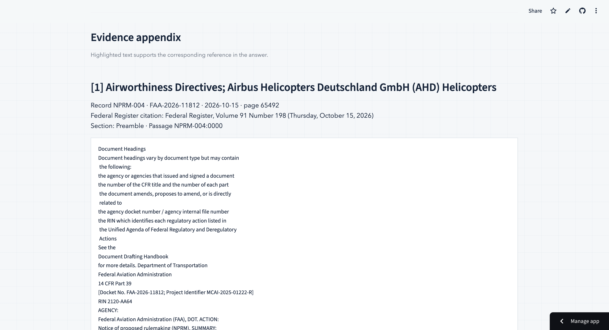
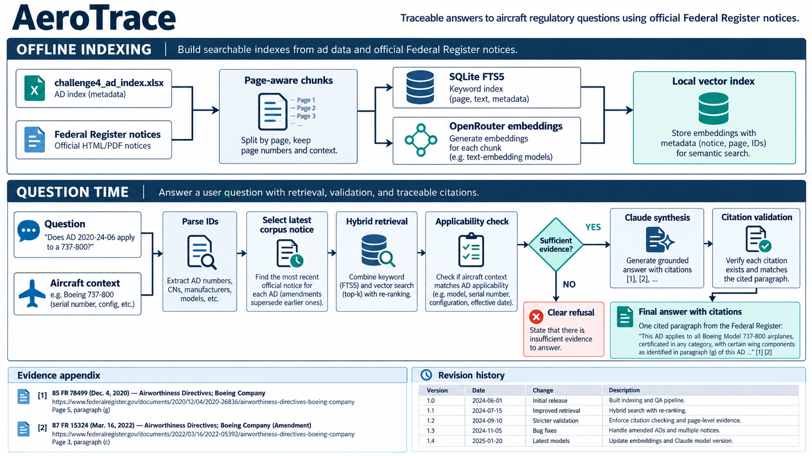
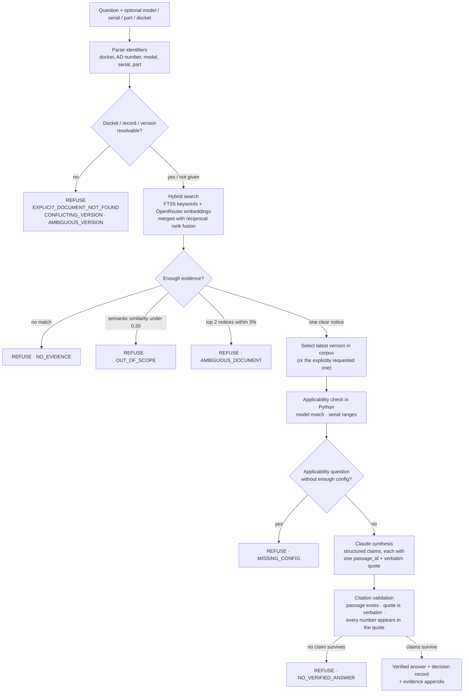

<p align="center">
  
</p>

<h1 align="center">AeroTrace</h1>

<p align="center">
  <b>Ask the proposal. Inspect the proof.</b><br>
  Traceable answers about FAA proposed Airworthiness Directives, with every claim tied to a verbatim passage of the official Federal Register notice.
</p>

<p align="center">
  <a href="https://aerotrace-x8czefwxnzhxxl9k7s4s3x.streamlit.app/"><b>🚀 Live demo</b></a> ·
  <a href="#how-it-works">How it works</a> ·
  <a href="#try-the-live-demo">Try it</a> ·
  <a href="#evaluation">Evaluation</a>
</p>

<p align="center">
  
  
  
  
  
</p>

> Autonomous SG 2026 · Challenge #4 · AI & Aerospace

---

## Try the live demo

**👉 [https://aerotrace-x8czefwxnzhxxl9k7s4s3x.streamlit.app/](https://aerotrace-x8czefwxnzhxxl9k7s4s3x.streamlit.app/)**

Nothing to install: open the link in any browser.

1. **Pick a benchmark question** from the buttons, or type your own.
2. *(Optional)* open **Aircraft details** and enter a model, serial number or part number for an applicability check.
3. Read the **verified answer**. Every sentence ends with a citation like **[1]**.
4. Check the **decision record**: docket, version, applicability result and retrieval time.
5. Scroll to the **evidence appendix** to see each cited passage from the official Federal Register notice, with the supporting text highlighted.

**Questions to try**

| Question | What you should see |
|---|---|
| What inspection does FAA-2026-11814 propose? | Verified answer with cited claims |
| What modification is proposed for the MBB-BK 117 D-2 fuel system? | Answer citing FAA-2026-11812 (see screenshot below) |
| Does FAA-2026-11814 apply to an EC135P2? | Does not apply: that model isn't listed |
| Does FAA-2026-11814 apply to my helicopter? | Refusal asking for the aircraft model (`MISSING_CONFIG`) |
| What is the recipe for chocolate cake? | Refusal: not about this corpus |

A full answer takes about 6–8 seconds, because Claude writes it and every claim is then validated. The first visit can take a little longer while the app wakes up.

## The problem

Airworthiness Directives decide whether an aircraft is safe to fly. The proposals behind them (NPRMs) are long Federal Register notices full of model lists, serial-number ranges, part numbers and revisions. A general chatbot can summarise them, but it can't prove where an answer came from, and a confident wrong answer about applicability is worse than no answer.

AeroTrace is built around one rule: **no claim without a receipt.** Every sentence in an answer cites an official passage and quotes it word for word. When the evidence isn't good enough, AeroTrace refuses and says why.

<details>
<summary>Original challenge statement</summary>


</details>

## What it does

- **Answers questions about 431 FAA AD proposals** using the full official text of each notice, fetched from the Federal Register: 5,651 page-aware, section-aware passages.
- **Cites everything.** Each claim carries a passage ID, page number, section and a verbatim quote, and the answer links to an evidence appendix with the supporting text highlighted.
- **Checks applicability with code, not the LLM.** Model and serial-number conditions are evaluated in Python. The result is `APPLIES`, `DOES_NOT_APPLY` or `UNKNOWN`, and Claude must report it, never recalculate it.
- **Tracks versions.** It knows when a docket has several notices, picks the latest one in the corpus by default, and lets you ask for a specific record, version or publication date.
- **Refuses safely** with a reason code: ambiguous question, unknown docket, missing aircraft details, out of scope, or no claim surviving validation.
- **Validates the LLM's output.** Any generated claim whose quote isn't in the cited passage, or which contains a number missing from its quote, is removed before you see it.

## Screenshots

| Ask a question | Verified answer + decision record |
|---|---|
|  |  |

**Evidence appendix.** Each citation `[n]` opens the official passage with its Federal Register citation, page, section and passage ID:



## How it works



<sub>Overview diagram. Example questions, citations and the version table in the image are illustrative; the exact pipeline is below.</sub>

### 1. Offline indexing (`scripts/build_index.py`)

| Step | Module | What happens |
|---|---|---|
| Import | `workbook.py` | Reads the 431 records in `challenge4_ad_index.xlsx` (docket, subject, make, models, publication date, citation) into SQLite. |
| Fetch | `fetch.py` | Resolves each docket to its official document through the Federal Register API (matching the publication date within ±3 days), downloads the full text and keeps the `[[Page N]]` markers. Runs 6 downloads in parallel and resumes where it stopped. |
| Chunk | `chunk.py` | Splits each notice into passages by page and lettered section (`(c) Applicability`, `(g) Required Actions`…); long sections are split at sentence boundaries (max ~2,200 characters). |
| Keyword index | `schema.py` | SQLite **FTS5** full-text index over the passages. |
| Vectors | `embed.py` | 1,536-dimension `text-embedding-3-small` embeddings through OpenRouter. They're reused when a passage's text hash and model haven't changed. |

The built index (`artifacts/index.sqlite`, `artifacts/embeddings.npy`, about 59 MB) is committed, so the app starts without rebuilding.

### 2. Answering a question (`engine.py`)



**Search.** Keyword search and vector search each return up to 100 passages. Their rankings are merged with reciprocal rank fusion (`1 / (60 + rank)`), and each notice is scored by its best passage. A docket, AD number or model named in the question restricts the search to matching notices before ranking.

**Applicability** (`rules.py`). The aircraft model must match a listed model. If the notice gives serial-number ranges, the serial must fall inside one of them, with prefixes and suffixes compared safely. Wording like "certain…" or "as specified in the service bulletin", where the conditions can't be parsed, gives `UNKNOWN` instead of a guess.

**Synthesis** (`synthesize.py`). Claude receives only the selected notice's passages (up to 7) and the verified checks, and returns structured JSON. The system prompt treats source text as untrusted data, forbids outside knowledge, and requires one claim per statement with one citation each. It also forbids reversing a verified refusal or recalculating applicability.

**Validation.** A claim is removed if its `passage_id` wasn't supplied, its `evidence_quote` isn't a verbatim substring of that passage, or it contains a number that isn't in its quote. Removed claims are kept in the JSON for audit.

### Refusal codes

| Code | Meaning |
|---|---|
| `EXPLICIT_DOCUMENT_NOT_FOUND` | The docket or record you named isn't in the corpus |
| `CONFLICTING_VERSION` | Record ID, docket, version or date point to different notices |
| `AMBIGUOUS_VERSION` | Several notices share the latest date; name a record |
| `NO_EVIDENCE` / `NO_MATCH` | No passage matches the question |
| `OUT_OF_SCOPE` | Best semantic match is below 0.30: the question isn't about this corpus |
| `AMBIGUOUS_DOCUMENT` | Two different notices match almost equally; add a docket or model |
| `SOURCE_UNAVAILABLE` | The official full text for the selected notice couldn't be fetched |
| `MISSING_CONFIG` | An applicability question needs a model and/or serial number |
| `NO_VERIFIED_ANSWER` | Claude's claims all failed citation validation |

## Evaluation

Measured by the team on 31 October 2026 against 431 fetched notices and 5,651 passages ([`eval/results.md`](aeroTrace-test/eval/results.md)):

| Retrieval mode | Held-out questions | Top-5 document recall | p50 latency | p95 latency |
|---|---:|---:|---:|---:|
| SQLite FTS5 keywords only | 10 | 90% | 3.2 ms | 19.3 ms |
| Keywords + OpenRouter embeddings | 10 | **100%** | 1,368 ms | 1,905 ms |

- The evaluation runner keeps target document IDs to itself: the engine sees only the question.
- In a sample end-to-end query, retrieval took about 1.4 s and Claude synthesis about 6.5 s. Two of Claude's claims were removed by the validator, and three verified claims were shown.
- The question set (10 dev + 10 held-out) was written during development and is small. It isn't an independent benchmark.

## Repository layout

```
aeroTrace-test/            ← the deployed AeroTrace app
  app.py                   Streamlit UI (question, verified answer, decision record, evidence appendix)
  aerotrace/
    workbook.py            import challenge4_ad_index.xlsx
    fetch.py               resolve + download official Federal Register text
    chunk.py               page- and section-aware passages
    schema.py              SQLite schema + FTS5 index
    embed.py               OpenRouter embeddings + vector index
    query.py               parse docket / AD / model / serial / part
    retrieve.py            hybrid search (FTS5 + vectors, reciprocal rank fusion)
    revision.py            version selection within a docket
    rules.py               deterministic applicability checks
    synthesize.py          Claude prompt, JSON schema, citation validation
    engine.py              the question pipeline and refusals
  artifacts/               bundled SQLite index + embeddings
  eval/                    questions and retrieval evaluation
  scripts/                 build_index.py, ask.py
  tests/
aerotrace/, app.py         earlier baseline: offline, extractive engine over data/ad_nprm.tsv,
                           with document uploads (PDF, Word, Excel, TSV)
docs/                      images and product requirements (PRD.md)
```

## Tech stack

Python · Streamlit · SQLite FTS5 · NumPy · OpenRouter (`text-embedding-3-small`) · Anthropic Claude · httpx · BeautifulSoup · openpyxl · pytest

## Limitations and next steps

- **These are proposals, not law.** The corpus contains NPRMs. "Latest" means latest in the supplied corpus, not the AD currently in force.
- **Applicability is deliberately conservative.** Conditions that depend on outside service information give `UNKNOWN`.
- **Validation isn't proof.** It confirms the passage, the verbatim quote and the exact numbers, but it isn't a full check that the sentence logically follows from the quote.
- **Speed:** retrieval is under 3 s, but a full answer takes about 6–8 s because of LLM synthesis.
- **Next:** a larger, independently written evaluation set; final-rule ADs alongside proposals; applicability parsing for part numbers and modification states.

## For developers

<details>
<summary>Run AeroTrace on your own machine</summary>

The deployed app lives in [`aeroTrace-test/`](aeroTrace-test/).

```bash
cd aeroTrace-test
python3 -m venv .venv && source .venv/bin/activate
pip install -r requirements.txt

cp .env.example .env          # then fill in the two keys below
streamlit run app.py
```

| Variable | Required | Purpose |
|---|---|---|
| `OPENAI_API_KEY` | yes | **OpenRouter** key (`sk-or-…`), used for query embeddings |
| `ANTHROPIC_API_KEY` | yes, for answers | Claude synthesis of cited answers |
| `AEROTRACE_EMBED_MODEL` | no | Default `text-embedding-3-small` (sent to OpenRouter as `openai/text-embedding-3-small`) |
| `AEROTRACE_LLM_MODEL` | no | Default `claude-sonnet-5-5` |
| `OPENROUTER_BASE_URL` | no | Default `https://openrouter.ai/api/v1` |

**Rebuild the index** (only needed if the workbook changes; it downloads all notices and re-embeds changed passages):

```bash
python scripts/build_index.py              # full build, resumable
python scripts/build_index.py --limit 20   # quick development build
python scripts/build_index.py --skip-fetch --skip-embed   # re-chunk only
```

**Ask from the terminal:**

```bash
python scripts/ask.py "What inspection does FAA-2026-11814 propose?"
```

**Tests and evaluation**

```bash
cd aeroTrace-test
pytest -q                                                  # unit tests
python eval/run_retrieval.py --split heldout --keyword-only
python eval/run_retrieval.py --split heldout               # hybrid
```

Two engine integration tests are skipped unless `OPENAI_API_KEY` is set; the evaluation script also needs that key to start.
</details>

## Disclaimer

AeroTrace is a research prototype for a hackathon. It is not an approved source of airworthiness information and must not be used to make maintenance or operational decisions. Always consult the official Federal Register notice and the current, legally effective AD.

## License

[MIT](LICENSE)
